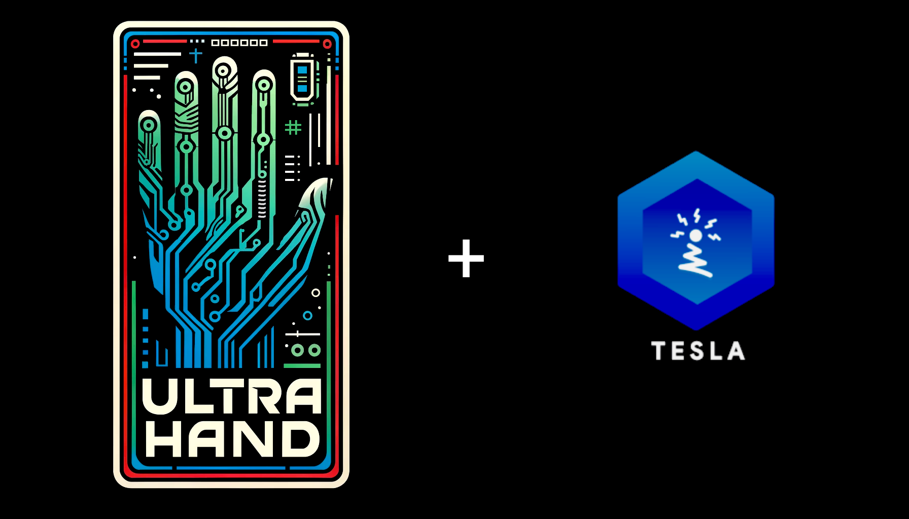

# ☆ libultrahand
[](https://gbatemp.net/forums/nintendo-switch.283/?prefix_id=44)
[](https://github.com/topics/cpp)
[](https://www.gnu.org/licenses/old-licenses/gpl-2.0.en.html)
[](https://github.com/ppkantorski/libultrahand/releases/latest)
[](https://github.com/ppkantorski/libultrahand/graphs/traffic)
[](https://github.com/ppkantorski/libultrahand/issues)
[](https://github.com/ppkantorski/libultrahand/stargazers)

An enhanced fork of [**libtesla**](https://github.com/WerWolv/libtesla) (originally by [WerWolv](https://github.com/WerWolv)) combined with the **libultra** utility library, for building Nintendo Switch overlays.



---

## Features

### Rendering & UI
- Fully anti-aliased rendering of rounded rects, uniform rounded rects, bordered rounded rects, and circles
- Frosted glass backdrop: a blurred, tinted copy of whatever is behind the overlay (live in games, and on the HOME menu and in applets). Every libultrahand overlay gets it automatically when `Frosted Glass` is on in Ultrahand (6 MB of overlay memory or more)
- Full color (8-bit) wallpapers and glass with more than 8 MB of overlay memory
- NEON fills, blending, and glyph drawing; small shapes are drawn without spawning render threads
- Global alpha limiter for smooth show/hide transitions and glyph rendering
- Rewritten `List` class with `jumpToItem`, proper wall handling, and no pointer caching
- Touch scrolling with momentum, and a draggable scroll bar that keeps a minimum length on long lists
- `TrackBar` and `TrackBarV2` with touch support, click animations, and haptic feedback
- `ToggleListItem`, `CategoryHeader` (with right-side value display), and other standard UI elements
- `OverlayFrame` / `HeaderOverlayFrame` with auto-scrolling titles and subtitles
- `swapTo` page navigation with crash-safe rapid input handling
- Font Manager with universal glyph cache and full multi-language glyph support
- Smooth list item text scrolling, shake-highlight at list boundaries

### Theming & Appearance
- Full `theme.ini` system with extensive color variables covering every UI surface
- Per-overlay theme overrides via `UI_OVERRIDE_PATH`, scoped to `/config/<OVERLAY_NAME>/`
- Wallpaper support (`.rgba`, 448×720 px) with heap-aware loading and optimized rendering
- Animated wallpapers (`.uaw`) streamed from the SD card, made with Ultrahand's `extra/make_uaw.py` or the [Ultrahand Wallpaper Designer](https://ppkantorski.github.io/Ultrahand-Wallpaper/)
- Ultrahand's per-wallpaper `Light` and `Color` presets (`wallpaper.ini`) are applied in every overlay
- Status bar widget with clock, temperature, battery, backdrop, and border (opt-in via `USING_WIDGET_DIRECTIVE`)
- Follows Ultrahand's `Theme Settings` (text border, uniform logo, bottom / divider / edge lines)

### Language & Localization
- Automatic string translation at render time via `drawString`
- Per-overlay language files (ISO 639-1 JSON) in `/config/<OVERLAY_NAME>/lang/`
- All language font glyphs accessible regardless of the active system language

### Sound & Haptics
- WAV sound effect playback (8–48 kHz, 16-bit PCM) via libnx `audout`, with volume control
- Sound and haptics each run on dedicated background threads for reliability and performance
- Haptic rumble patterns for click and double-click feedback
- Separate button and touch haptics (`ult::useButtonHaptics`, `ult::useTouchHaptics`, replacing `ult::useHapticFeedback`)

### Notifications
- Multi-slot toast notification system (up to 8 concurrent; 4 on 4MB heap)
- JSON-based API notifications written to `/config/ultrahand/notifications/` by any app
- Optional notification icons (50×50 RGBA), titles, timestamps, duration, alignment, and font size
- Per-app notification filtering via flag files; API toggle hotkey for live enable/disable
- `tsl::notification->show` and `tsl::notification->showNow` for queued and immediate display
- Optional Switch 2 style notifications with their own outline color (`notification_border_color`)

### Input
- Full touch support alongside controller input: tap, hold, swipe, drag, and fling
- Holding a direction steps at a steady pace (timed after the Switch 2), with its own lighter hold sound
- Configurable per-item touch, hold, and release behavior on `ListItem`
- `tsl::shiftItemFocus` for programmatic focus control

### Network & Downloads
- curl-based file downloads with retry logic and NTP auto-sync for SSL reliability
- Internet access verification before initiating downloads
- Per-download socket init/exit to minimize memory pressure

### libultra Utilities
- **File & path**: copy, move, delete, mkdir, wildcard matching, directory traversal, dot-clean
- **INI**: full read/write, section and key management, pattern-matched bulk edits
- **JSON**: read/write via cJSON (migrated from jansson)
- **Hex**: binary file editing by offset, swap, string, decimal, reversed decimal, and custom pattern
- **Strings**: trim, split, format, version parsing, placeholder resolution
- **Lists**: file-backed list reading, set operations, filtering
- **Mod conversion**: `.pchtxt` to `.ips` or Atmosphere cheat format (with `@disabled` flag support)
- **Images**: PNG to RGBA conversion (`convertPngToRgba`)
- **Debug**: thread-safe timestamped logging via `USING_LOGGING_DIRECTIVE`

### Compatibility & Integration
- Full drop-in replacement for libtesla. Existing Tesla overlays work without modification
- All overlays act as combo launchers for any overlay registered in Ultrahand's `overlays.ini`
- Launch Recall: combo re-entry returns to the exact overlay/package previously launched
- Ultrahand signature (`ULTR`) embedded at link time to enable first-class Ultrahand integration
- Unsupported overlay warning when launching overlays compiled against incompatible AMS versions

---

## Build Examples

A growing ecosystem of libultrahand-based overlays, all launchable and manageable directly from [Ultrahand Overlay](https://github.com/ppkantorski/Ultrahand-Overlay):

| Overlay | Description |
|---|---|
| [Ultrahand Overlay](https://github.com/ppkantorski/Ultrahand-Overlay) | Fully scriptable overlay menu ecosystem and the main libultrahand reference |
| [Status Monitor](https://github.com/ppkantorski/Status-Monitor-Overlay) | Real-time CPU/GPU/RAM, temps, battery, and frequency stats |
| [sys-clk](https://github.com/ppkantorski/sys-clk) | Per-game CPU/GPU/memory overclocking and underclocking |
| [FPSLocker](https://github.com/ppkantorski/FPSLocker) | Custom FPS targets and display refresh rates for retail games |
| [Fizeau](https://github.com/ppkantorski/Fizeau) | Color temperature, saturation, gamma, and contrast adjustment |
| [ovl-sysmodules](https://github.com/ppkantorski/ovl-sysmodules) | Toggle system modules and monitor memory usage on the fly |
| [QuickNTP](https://github.com/ppkantorski/QuickNTP) | One-tap NTP time sync |
| [NX-FanControl](https://github.com/ppkantorski/NX-FanControl) | Custom fan curve control |
| [Tetris](https://github.com/ppkantorski/Tetris-Overlay) | Fully playable Tetris running as an overlay |
| [UltraGB](https://github.com/ppkantorski/UltraGB-Overlay) | Game Boy / GBC emulator running on top of any game |
| [ReverseNX-RT](https://github.com/ppkantorski/ReverseNX-RT) | Per-game handheld/docked mode switching |
| [SysDVR](https://github.com/ppkantorski/sysdvr-overlay) | SysDVR stream control overlay |
| [EdiZon](https://github.com/proferabg/EdiZon-Overlay) | In-game cheat and save editor |
| [DNS-MITM Manager](https://github.com/ppkantorski/DNS-MITM_Manager) | DNS-based network filtering management |

---

## Compiling

### Prerequisites

- [devkitPro](https://devkitpro.org) with `devkitA64` and `libnx`
- The following pacman packages:

```sh
(dkp-)pacman -S switch-curl switch-zlib switch-minizip switch-mbedtls
```

> `switch-minizip` is only required if your overlay uses download or unzip functionality.

### MSYS2 Users

MSYS2 will mangle compiler arguments that start with `/` (like devkitPro paths and flags), causing build failures. Prevent this by adding the following to your `~/.bashrc`:

```sh
if [[ -n "${DEVKITPRO:-}" ]]; then
    export MSYS2_ARG_CONV_EXCL='*'
fi
```

Then reload your shell:

```sh
source ~/.bashrc
```

This disables MSYS2's argument conversion entirely when building with devkitPro and avoids any path-mangling issues.

### Adding libultrahand to Your Project

The easiest way is to use `ultrahand.mk`. Add this after your `SOURCES` and `INCLUDES` definitions, adjusting the path to where you placed `libultrahand`:

```makefile
include $(TOPDIR)/lib/libultrahand/ultrahand.mk
```

Alternatively, add these manually:

```makefile
SOURCES  += lib/libultrahand/common lib/libultrahand/libultra/source lib/libultrahand/libtesla/source
INCLUDES += lib/libultrahand/common lib/libultrahand/libultra/include lib/libultrahand/libtesla/include
```

### Required Libraries

```makefile
LIBS := -lcurl -lz -lminizip -lmbedtls -lmbedx509 -lmbedcrypto -lnx
```

`-lminizip` can be omitted for overlays that do not use download or unzip functionality.

### Services

libultrahand initializes the following libnx services. If your project already initializes any of these, remove the duplicates to avoid conflicts:

```cpp
fsdevMountSdmc();
splInitialize();
spsmInitialize();
ASSERT_FATAL(socketInitializeDefault());
ASSERT_FATAL(nifmInitialize(NifmServiceType_User));
ASSERT_FATAL(smInitialize());
```

`i2cInitialize()` is only used when `USING_WIDGET_DIRECTIVE` is enabled.

For `libultra` download methods, also call these in your service init/exit:

```cpp
initializeCurl();   // in initServices()
cleanupCurl();      // in exitServices()
```

### Recommended Build Flags

The following reflects the flag set used across official libultrahand projects. The target architecture is ARMv8-A on the Cortex-A57:

```makefile
ARCH := -march=armv8-a+simd+crc+crypto -mtune=cortex-a57 -mtp=soft -fPIE

CFLAGS := -Wall -Os \
          -ffunction-sections -fdata-sections \
          -fomit-frame-pointer -fuse-linker-plugin \
          -finline-small-functions -fno-strict-aliasing \
          -frename-registers -falign-functions=16 \
          $(ARCH) $(DEFINES)

CXXFLAGS := $(CFLAGS) -std=c++23 \
            -fno-exceptions -fno-rtti \
            -fno-unwind-tables -fno-asynchronous-unwind-tables \
            -ffast-math -Wno-dangling-else

LDFLAGS := -specs=$(DEVKITPRO)/libnx/switch.specs \
           $(ARCH) -Wl,-Map,$(notdir $*.map) \
           -Wl,--gc-sections -Wl,--as-needed
```

> `-fno-exceptions` and `-fno-rtti` are strongly recommended for overlay binaries. If `USE_EXCEPTION_WRAP` is enabled, `-fno-unwind-tables` and `-fno-asynchronous-unwind-tables` should be set as well.

### Link-Time Optimization

LTO is highly recommended and should use parallel LTRANS jobs for faster builds. The simplest approach is to auto-detect the available CPU count:

```makefile
NPROC := $(shell getconf _NPROCESSORS_ONLN 2>/dev/null || nproc 2>/dev/null || echo 1)

CXXFLAGS += -flto=$(NPROC)
LDFLAGS  += -flto=$(NPROC) -fuse-linker-plugin
```

Or specify a fixed thread count (e.g. for CI environments):

```makefile
CXXFLAGS += -flto=6
LDFLAGS  += -flto=6 -fuse-linker-plugin
```

### Ultrahand Signature

All libultrahand overlays should append the `ULTR` four-byte signature to the final `.ovl` binary. This is how Ultrahand identifies libultrahand-compiled overlays in the overlay menu:

```makefile
$(OUTPUT).ovl: $(OUTPUT).elf $(OUTPUT).nacp
	@elf2nro $< $@ $(NROFLAGS)
	@printf 'ULTR' >> $@
```

---

## Makefile Directives

All directives should be added to both `CFLAGS` and `CXXFLAGS` unless your `CXXFLAGS` is already defined as `$(CFLAGS)`, in which case adding to `CFLAGS` before that line is sufficient.

### Theme & Wallpaper Override

Scopes a `theme.ini` and `wallpaper.rgba` to your overlay at `/config/<OVERLAY_NAME>/`. An animated `wallpaper.uaw` in the same folder is used before `wallpaper.rgba`:

```makefile
UI_OVERRIDE_PATH := /config/<OVERLAY_NAME>/
CFLAGS   += -DUI_OVERRIDE_PATH="\"$(UI_OVERRIDE_PATH)\""
CXXFLAGS += -DUI_OVERRIDE_PATH="\"$(UI_OVERRIDE_PATH)\""
```

If the theme still does not appear, add the `INITIALIZE_IN_GUI_DIRECTIVE` as a fallback:

```makefile
CFLAGS   += -DINITIALIZE_IN_GUI_DIRECTIVE=1
CXXFLAGS += -DINITIALIZE_IN_GUI_DIRECTIVE=1
```

### Language Translations

Requires `UI_OVERRIDE_PATH`. Place ISO 639-1 named JSON files in `/config/<OVERLAY_NAME>/lang/`:

```json
{
  "English String": "Translated String",
  "Another String": "Another Translation"
}
```

Translation is applied automatically on every `drawString` call based on the active Ultrahand language setting.

### Status Bar Widget

```makefile
CFLAGS   += -DUSING_WIDGET_DIRECTIVE=1
CXXFLAGS += -DUSING_WIDGET_DIRECTIVE=1
```

Activates `i2cInitialize()` internally, so remove it from your own service init if present.

### Logging

Enables thread-safe file logging to `<packagePath>/log.txt` via `logMessage()`. Useful for debugging command execution and overlay behavior:

```makefile
CFLAGS   += -DUSING_LOGGING_DIRECTIVE=1
CXXFLAGS += -DUSING_LOGGING_DIRECTIVE=1
```

### Glass Panel

Lets your overlay draw frosted glass under a freely placed panel with `renderer->drawGlassPanel(x, y, w, h, radius, color)`. Panels larger than the menu column (56×90 cells of 8 px) also need their largest size in cells:

```makefile
CFLAGS   += -DUSING_GLASS_PANEL_DIRECTIVE=1
CXXFLAGS += -DUSING_GLASS_PANEL_DIRECTIVE=1
# Optional, only for panels larger than the menu column
CFLAGS   += -DGLASS_PANEL_MAX_W=160 -DGLASS_PANEL_MAX_H=90
CXXFLAGS += -DGLASS_PANEL_MAX_W=160 -DGLASS_PANEL_MAX_H=90
```

### Glass One Buffer

Shares one buffer between the glass's screenshot and live game reads (480 KB less memory). Useful for overlays that are tight on memory:

```makefile
CFLAGS   += -DUSING_GLASS_ONE_BUFFER_DIRECTIVE=1
CXXFLAGS += -DUSING_GLASS_ONE_BUFFER_DIRECTIVE=1
```

### Favorites

List items whose text starts with the star symbol (`ult::STAR_SYMBOL`) draw the star in Ultrahand's star colors:

```makefile
CFLAGS   += -DUSING_FAVORITES_DIRECTIVE=1
CXXFLAGS += -DUSING_FAVORITES_DIRECTIVE=1
```

### Live Logging

For test builds only. Writes frame timing and glass diagnostics to `/config/ultrahand/live_logging.log` while `live_logging` is on in `config.ini`. Leave it out of release builds:

```makefile
CFLAGS   += -DUSING_LIVE_LOGGING_DIRECTIVE=1
CXXFLAGS += -DUSING_LIVE_LOGGING_DIRECTIVE=1
```

### Back Button Override

Disables the default back-button (`KEY_B`) behavior, allowing your overlay to handle it independently. Useful for overlays that implement custom or full-screen navigation:

```makefile
CFLAGS   += -DNO_BACK_KEY_DIRECTIVE=1
CXXFLAGS += -DNO_BACK_KEY_DIRECTIVE=1
```

### Targeted Optimizations

```makefile
# Apply -O3 to rendering components only (tesla.hpp)
CFLAGS   += -DTESLA_TARGETED_SPEED
CXXFLAGS += -DTESLA_TARGETED_SPEED

# Apply -Os to libultra utility components only
CFLAGS   += -DULTRA_TARGETED_SIZE
CXXFLAGS += -DULTRA_TARGETED_SIZE
```

These can be used together: `TESLA_TARGETED_SPEED` optimizes the hot rendering path while `ULTRA_TARGETED_SIZE` keeps utility code compact.

### Launcher Build

Enables launcher-specific code paths used exclusively when building the Ultrahand Overlay launcher itself. Not intended for general overlay development:

```makefile
CFLAGS   += -DIS_LAUNCHER_DIRECTIVE=1
CXXFLAGS += -DIS_LAUNCHER_DIRECTIVE=1
```

### Exception Wrap (~20KB size reduction)

Intercepts C++ exception entry points at the linker level, eliminating unwind table overhead. Requires including `<exception_wrap.hpp>` at the top of your `main.cpp`:

```makefile
CFLAGS   += -DUSE_EXCEPTION_WRAP=1
CXXFLAGS += -DUSE_EXCEPTION_WRAP=1
CXXFLAGS += -fno-exceptions -fno-unwind-tables -fno-asynchronous-unwind-tables
LDFLAGS  += -Wl,-wrap,__cxa_throw \
            -Wl,-wrap,_Unwind_Resume \
            -Wl,-wrap,__gxx_personality_v0
```

---

## Contributing

Contributions are welcome. Please open an [issue](https://github.com/ppkantorski/libultrahand/issues/new/choose), submit a [pull request](https://github.com/ppkantorski/libultrahand/compare), or reach out on [GBATemp](https://gbatemp.net/threads/ultrahand-overlay-the-fully-craft-able-overlay-executor.633560/).

[](https://ko-fi.com/X8X3VR194) [](https://github.com/sponsors/ppkantorski)

---

## License

Licensed under [GPLv2](LICENSE) with a [custom library](libultra) under [CC-BY-4.0](SUB_LICENSE).

Copyright © 2023–2026 ppkantorski
